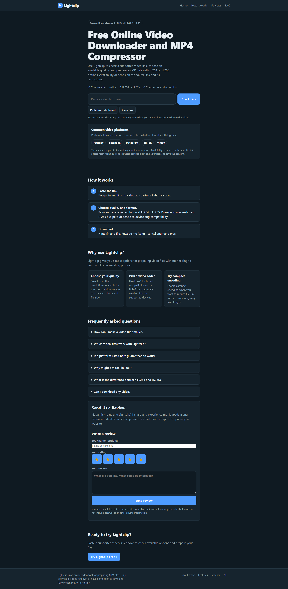

# Lightclip

A web app for downloading and processing videos, built with Flask, `yt-dlp`, and FFmpeg.

> **Project status:** Revised local build. Confirm supported sources and deployment requirements before publishing this project publicly.

## Web App Screenshot

Add a real screenshot of the running Lightclip web app at `screenshots/lightclip-homepage.png`. The image will appear here automatically on GitHub.



**How to add the screenshot**
1. Run the app locally using the instructions below.
2. Open `http://127.0.0.1:5000` in your browser.
3. Take a screenshot of the page.
4. Create a folder named `screenshots` in the project root.
5. Save the image as `screenshots/lightclip-homepage.png`.

If the screenshot uses another filename or format, update the image path above to match it.

## Features

- Flask-powered web application.
- Video download handled by `yt-dlp`.
- FFmpeg processing for compact encoding when enabled.
- Progress polling from Flask, including download bytes/speed and FFmpeg processing progress when compact encoding is used.
- Automatically triggers the file download when the result is ready.

## Requirements

- Python 3
- Packages listed in `requirements.txt`
- FFmpeg installed and available to the app if your configured workflow uses FFmpeg

## Run Locally

Open a terminal in the project folder and run:

```bash
pip install -r requirements.txt
python app.py
```

Then open:

<http://127.0.0.1:5000>

## Browser Download Behavior

A website cannot force the browser to use a specific download folder. Lightclip triggers the download when the file is ready; Chrome or Edge saves it according to the browser's Downloads settings.

To change this behavior in Chrome or Edge, open **Settings → Downloads** and adjust **Ask where to save each file before downloading**.

## Project Structure

```text
lightclip/
├── app.py
├── requirements.txt
├── README.md
├── .gitignore
└── static/
```

The actual contents of `static/` may include the app's frontend assets.

## Deployment Notes

This project uses a Flask backend and may run `yt-dlp` and FFmpeg. A frontend-only deployment is not sufficient for these backend features. Before deploying, confirm that the selected hosting platform supports the app's Python runtime, FFmpeg dependency, outbound network access, and the duration and resource needs of video-processing jobs.

Do not commit `cookies.txt`, `.env` files, login/session cookies, API keys, passwords, or other secrets to GitHub. Keep sensitive files excluded in `.gitignore`.

## License

Add a license before redistributing this project publicly.
